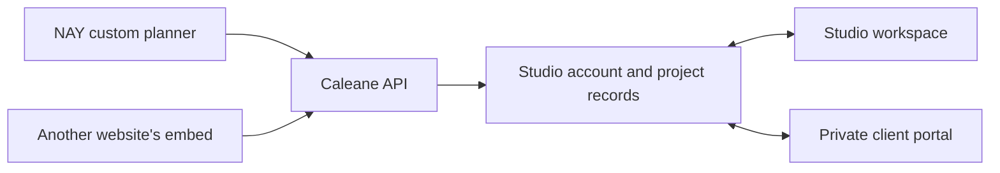

# A shared workspace for creative projects

## The product

A creative business needs a continuous record from first enquiry to approved direction. A client needs one place to explain the idea, see the work and make decisions. The client relationship is the organising record; projects are shared workspaces within that relationship. This is a CRM and business platform for service businesses, with creative collaboration as a specialisation.

NAY is the prelaunch founder scenario and first connected website. It has not yet produced a real customer journey. The product lives separately so another business can have its own account, branding, customers and website connection. A subscription business is a possible later model; no billing or commercial plan has been assumed in this build. Bespoke event studios and wedding/event planners are parallel external discovery candidates; neither is a validated first ICP.

## Three surfaces

1. **Website entry:** the business’s custom planner, a hosted link or the reusable embedded planner.
2. **Studio workspace:** all of that studio’s enquiries and projects, plus clients and website connections.
3. **Client portal:** only that client’s projects, with shared briefs, inspiration, designs, conversations, decisions and invoices when they are an Approver.

The website owns its design. The workspace owns saved project data and access rules. A website never receives private studio credentials. Moving the app to its own repository and domain changes its address, not this boundary.

## The first journey

A client completes an enquiry without creating an account. The system saves it once and returns a reference. The studio reviews the brief and sends a private invitation when it wants to begin working together. The client follows the link, creates an account or signs in, and sees their project.

Both sides can develop the brief and add references. The studio shares a design version against a particular brief revision. The client can approve that version or request changes. The record shows who decided, when, and what was being approved.

An approved brief is protected. New edits become change requests. Accepting a request updates the working brief and returns the project to design; the previous approval remains attached to the historical design. A new version must be shared to obtain fresh approval.

A design approval is a creative decision in this product. It does not represent a payment, signed contract or confirmed booking.

## Data and authority

- **User:** one identity with a password hash and server sessions.
- **Studio:** one business, its brand settings and connected website origins.
- **Membership:** the user’s role in a studio. The local app has studio owners, clients and studio members. Members start read-only and can contribute to individual projects only when an owner assigns them.
- **Client account:** an owner-only relationship record with stage, tags, source, follow-up and private studio notes. It has a stable ID, an optional organisation and several contacts. The older primary email remains for compatibility; project/account links now use stable IDs.
- **Contact and participation:** each person has a tenant-scoped contact ID, editable contact details and optional organisation. A project has explicit participants: Viewer can read, Collaborator can contribute, Approver can also decide on the latest design and planning estimate. Portal identity binds to the contact ID when its invitation is claimed. The studio can revoke or change a secondary participant's project role.
- **Opportunity:** an owner-only possible engagement with a stage, value, probability, source, expected close and optional delivery project. Opportunity stage tracks the sale; project stage tracks the creative work. A project inherited from a pre-existing enquiry starts in Discovery, even if a design was approved.
- **CRM activity and next step:** calls, meetings, email interactions, notes and dated tasks live with the client. They may also belong to one opportunity. Logging an email interaction records what happened; it does not send an email.
- **Project:** belongs to exactly one studio and one durable client account through a tenant-scoped relationship link; holds the working brief and collaboration record. Its original client email remains in the historical brief.
- **Brief revision:** a saved version, including its prior contents.
- **Inspiration:** a reference link, note, image or PDF within a project.
- **Design version:** a title, description, optional project file, brief snapshot and decision record.
- **Change request:** proposed edits after approval, with a decision from the studio.
- **Message and activity:** project-linked correspondence and a record of changes; unread state belongs to each user.
- **Task:** shared responsibility assigned to the studio or client.
- **Estimate:** itemised planning amounts, versioned against the brief; a client can confirm a budget or request changes.
- **Invoice:** owner-issued deposit, balance or full charge against the latest confirmed estimate, with an immutable seller, customer, scope and amount snapshot. Only the project Approver can read it in the portal.
- **Payment record:** an owner-entered note that an external bank, Stripe, PayPal or other payment occurred. It changes the displayed balance but is not provider verification or in-app collection.
- **Invitation:** expiring, single-use access to that client’s projects within the studio.

Every private project, conversation and file request checks the signed-in user’s studio membership and explicit account/project participation on the server. A client cannot share designs as the studio, move project stages or approve another client’s work. A studio cannot approve a design on behalf of a client. Switching a URL or request identifier is insufficient to change access.

The server rejects a save from an old brief revision. The UI keeps the edit’s starting revision even while other project data refreshes, so a background update cannot silently overwrite someone else’s changes.

## Product rules worth preserving

- Keep the client’s first enquiry short. Let the project grow after contact.
- Keep draft ideas, design decisions and booking commitments distinguishable.
- Never replace an approved file or version in place.
- Never promise that a notification or email was sent without a delivery result.
- Keep shared and internal information separate. CRM notes and follow-ups are private to studio owners; project messages, tasks, designs and estimates are shared with the assigned client.
- Keep all public intake routes write-only. Invite links never come back in an anonymous enquiry response.
- Give the website owner a choice: custom form, hosted planner or embed.
- Treat each business’s data as private, even if two studios work with the same client email.

## Next phases

The [service journey and relationship graph](SERVICE_JOURNEY.md) separates the implemented contact/stakeholder foundation from lead qualification, sale, booking, payment and delivery operations.

### Make the first studio operational

Add real invitation and notification delivery, recovery, onboarding and an owner-controlled retention policy. Test the implemented opportunity pipeline, CRM tasks, client activities, unread messages and next-action view with NAY prototype scenarios and observed projects from operating studios. The selected Studio Folio correspondence interface is implemented, with client/project context taking priority over chat bubbles. General client conversations and project conversations share the canonical message store.

### Commercial work

Planning estimate versions and scope items exist. Owners can issue deposit, balance and full invoices from a confirmed estimate, and record external payments, including partial amounts. The Finance ledger groups invoices across projects. Add contractual quote acceptance, provider-connected collection and reconciliation, contracts and booking dates. Each needs its own authority and state: a design approval must not mark an invoice paid or a date reserved. Future provider-verified payment state must remain distinguishable from the current owner-entered records. Signed documents must retain their exact contents and audit evidence.

### A product other studios can buy

Project-scoped staff can now prepare private design drafts with their own uploaded files; the owner alone reviews and shares a client version. Configurable enquiry questions can depend on an earlier single-choice answer. Extend these local foundations with wider editorial roles, richer form logic, custom domains, reusable studio templates, shared storage, quotas and billing. Theme the client portal and planner per studio. Keep account administration and cross-studio support access explicit and auditable.

### Automation and integrations

Add email/calendar/CRM integrations through narrow adapters. Track delivery status and retries. Keep a human approval step for customer-facing creative decisions. Avoid automatically changing accepted scope because an email or external note mentions an idea.

## Naming and visual direction

The current visible product name is **Caleane**, with the original Instrument Sans wordmark and the supplied Shared Frame symbol. The dark green navigation rail and warm paper workspace are the current visual direction. Historical folder names, asset paths and environment variables retain Calenne for compatibility. The sample-only marketing website is public on Vercel; the multi-user workspace remains local. `calenne.co` has not been registered or connected, and trademark clearance remains open. The client directory, record tabs, correspondence workspace, pipeline, projects, calendar, finance and settings use one shared shell. NAY’s public website keeps its own identity.
