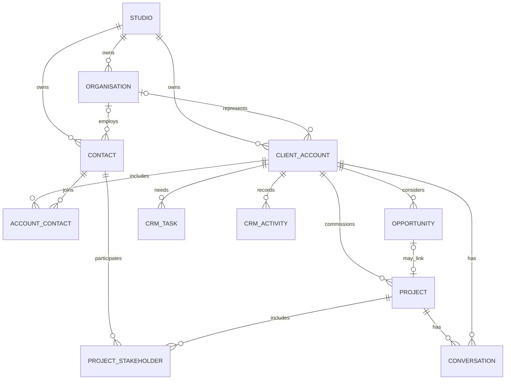

# Calenne product map, using NAY DÉCOR as the first case — 29 September 2026

**Historical baseline:** this table records the 29 September gap assessment. Current implementation and launch state are maintained in [docs/READINESS.md](docs/READINESS.md) and [docs/design/IMPLEMENTATION-MAP.md](docs/design/IMPLEMENTATION-MAP.md).

## How to read this map

**This is a map of the Calenne software product.** NAY DÉCOR is the first studio using it, so NAY-style event work provides concrete examples. It is not a map of NAY's public website or a claim that every example is a current NAY service.

| Layer | Role in this map |
| --- | --- |
| **NAY DÉCOR** | A creative service business with its own name, website, clients and projects. Its website can send enquiries to its private studio account in Calenne. |
| **Calenne** | The separate software platform: client records, opportunities, projects, collaboration, and a client portal. The graph, implementation status and build roadmap below describe Calenne. |
| **Future studios** | Other businesses can use the same Calenne product with separate accounts, data, branding and websites. They do not share NAY's client records. |

In the journey table, the first two columns are **example service jobs**. The last column says what **Calenne currently supports locally** and what software is still missing. “Local”, “Partial” and “Missing” do not rate how NAY runs its business outside this app. `calenne.co` is the chosen Calenne domain, pending registration and deployment; it is not NAY's website address.

## Calenne's relationship data model

`CLIENT_ACCOUNT` is the existing `clients` record. Its stable ID now links to a project through `crm_project_relationships`; the old `projects.client_email` and project JSON remain as historical intake data and for compatibility. A contact has its own stable ID and email. An account can have several contacts, one primary contact and one optional organisation. A contact can be associated with several accounts. Project stakeholders have explicit Viewer, Collaborator or Approver roles. A portal user is bound to a contact ID when an invitation is claimed. Tenant membership is checked before any participant access; the project or account link is checked again for each resource.

This is a foundation, not a complete account model. A new client account still requires a primary email, and the old `clients.email` column retains a unique constraint for compatibility. Contact email changes update that primary address while leaving historical project snapshots unchanged. A claimed portal account continues to use its existing sign-in email; changing it requires a future verified account-email flow. The UI says so and a replacement invitation to the changed address is blocked.

## Example service journeys against Calenne's current state

| Step | Example: NAY private event / wedding | Example: brand launch / venue work | Calenne locally today / gap |
| --- | --- | --- | --- |
| Capture | Client or planner submits the event brief. | Marketing buyer, venue manager or referral starts an enquiry. | **Local:** website/embedded intake creates an idempotent project and Discovery opportunity. **Gap:** distinct enquiry/lead record, qualification status and source evidence. |
| Qualify | Check date, location, budget, fit and decision maker. | Identify the organisation, campaign owner, procurement and venue contacts; distinguish renewal from new work. | **Partial:** client, contact, organisation, opportunity source and CRM activity. **Gap:** lead owner, qualification outcome, disqualification reasons and routing. |
| Consult | Call with couple or planner; record design priorities and venue constraints. | Discovery with brand and venue teams; log stakeholders and decision path. | **Partial:** manual call/meeting activity, CRM tasks and brief. **Gap:** assigned staff, linked calendar, structured discovery and consent. |
| Scope | Define design, production, install and strike, hire and exclusions. | Multiple spaces, deliverables, campaign dates, usage and recurring terms. | **Partial:** revisioned brief and itemised planning estimate. **Gap:** formal versioned scope and client-facing proposal. |
| Propose | Send a bounded offer with acceptance date. | Route offer through buyer/procurement and creative approver. | **Missing:** proposal delivery, expiry, acceptance evidence and commercial approval. Opportunity stage "Proposal" is only a label. |
| Contract / deposit | Agree terms, sign and receive deposit before treating the date as booked. | Capture purchase order or contract, milestone invoices and payment. | **Partial:** owner-issued deposit, balance and full invoices from confirmed estimates; owner-recorded external payments. **Gap:** contract, e-signature evidence, provider-verified payment state and date hold/booking authority. Creative approval and budget confirmation never imply these. |
| Schedule | Confirm site visit, venue access, supplier load-in and strike. | Coordinate brand approvals, fabrication, install and venue operations. | **Partial:** one brief date and shared tasks. **Gap:** resource capacity, venue, schedule, supplier and inventory records. |
| Design / deliver | Share immutable design versions, get feedback and approver decision; deliver the event. | Review with brand approver, track production changes and execute installation. | **Local:** brief revisions, design versions, pinned feedback, change requests, files and project conversations. **Gap:** production run sheet, cost control, internal approvals and delivery evidence. |
| Handover / follow up | Final notes, photos, final balance and anniversary follow-up. | Asset handover, performance review, next campaign or venue refresh. | **Partial:** project Complete state, private notes, follow-up date and CRM tasks. **Gap:** handover package, final payment, satisfaction, referral and renewal workflows. |

### Authority boundaries

- The **opportunity** is a possible sale. Discovery, Qualified, Proposal, Negotiation, Won and Lost are currently manually set sales stages; Won is not backed by a contract or payment event.
- The **project** is collaborative creative work. Its Enquiry, Planning, Design, Approved, Complete and Archived states describe work, not a legal booking.
- An **estimate** is a planning document. A client's budget confirmation is not a signed quote, invoice or deposit. It permits the owner to issue a separate invoice.
- An **invoice** snapshots the seller, customer, confirmed estimate and amount. Its balance changes only when the owner records an external payment; that entry has not been verified by a provider.
- A **design approval** is the recorded decision of a project Approver on one version and one brief revision. It is not a booking or payment state.
- A **manual Email activity** records a past interaction. Only the in-app conversation has actually been stored in this product; external email has not been sent or synced.

## Why this shape

[Frappe CRM's first-steps guide](https://docs.frappe.io/crm/setup-guide/your-first-steps-with-frappe-crm) distinguishes a lead from a deal and brings contacts, organisations, tasks and history through conversion. Its [lead](https://docs.frappe.io/crm/lead), [organisation](https://docs.frappe.io/crm/organization), [task](https://docs.frappe.io/crm/task) and [email](https://docs.frappe.io/crm/email-communication) guides show the value of a genuine account/contact graph, assigned next steps and two-way correspondence. Calenne has part of that graph in NAY's studio account; the product still needs separate qualification, staff ownership and actual email delivery.

[HoneyBook](https://help.honeybook.com/en/articles/6554485-manage-your-leads-in-honeybook) treats a lead as unbooked and a client as booked after contract or payment. Its [pipeline guidance](https://help.honeybook.com/en/articles/2463528-customize-your-pipeline-in-honeybook) supports tailored stages and views. That distinction prevents us from calling every enquiry a booked client. [Dubsado's proposal guide](https://help.dubsado.com/en/articles/3508875-what-is-a-proposal) joins service selection, contract and invoice in a client-facing flow. Those commercial records need their own authority rather than borrowing creative approval. [ChurchCRM's Person model](https://docs.churchcrm.io/user-guide/persons) separates people, groupings and users; its family rules are domain-specific, so only the modelling lesson applies here. [OWASP's tenant guidance](https://cheatsheetseries.owasp.org/cheatsheets/Multi_Tenant_Security_Cheat_Sheet.html) calls for a server-verified tenant context and resource-level checks, implemented here for relationship and participant APIs, with further operational review still needed.

Repository review was for concepts only. [Frappe CRM](https://github.com/frappe/crm) is a Frappe/Python backend with a Vue frontend and the repository advertises AGPL-3.0; no code was copied. [ChurchCRM](https://github.com/ChurchCRM/CRM) is a church-oriented PHP application whose repository advertises MIT; no code was copied. The saved Atomic CRM and Better Auth trees have MIT licences; saved Chatwoot has MIT community code and a separate restricted `enterprise/` licence. None of those applications was merged into this workspace.

## Next Calenne build slices

1. **Lead and ownership:** a first-class enquiry/lead with qualification outcome, one responsible staff member, conversion to opportunity and auditable source. This requires staff membership roles before assignment can mean anything.
2. **Commercial commitment:** versioned proposal and scope, acceptance evidence, date hold, contract and provider-verified deposit. The invoice and manual payment-record foundation exists; preserve the four independent states: sale, booking, money and design.
3. **Operations:** venue and service dates, site visits, supplier/resource assignments, production timeline, delivery checklist, handover and renewal. Modules should be optional for businesses outside events.
4. **Real channels and SaaS operations:** outbound/inbound email with delivery state and retries, account recovery and verification, shared database/storage for more than one server, backups/restore, rate limits, audit/retention/export, domains, plans and support controls.

The local relationship slice has been exercised with an isolated browser demo and temporary-database HTTP tests. The existing live `data/workspace.sqlite` was **not** migrated during this task; a consistent pre-migration backup is at `data/backups/pre-relationships-2026-09-29.sqlite`. On the next server start, schema installation and idempotent backfill create the relationship links without rewriting project JSON, IDs, files, decisions or conversations.
