# Caleane — full-page audience and imagery review

Captured 1 October 2026 from local browser at 1280 × 720. Visual/positioning review, not audience research or full accessibility testing. No website edits in this audit.

## Verdict
The visual identity is coherent, but the cumulative imagery suggests a platform primarily for women-led luxury event, interior and styling studios. This is an interpretation of the page, not a claim about actual visitors or the identities of pictured people. Broaden visible work and casting while retaining the grading and human tone.

## 1. Hero — Strong identity; narrow casting

The close-up portrait is memorable, but conveys little about the work. Across the selected photo direction, dark clothing and polished portraiture create a highly specific studio persona. Keep one signature close-up; show context in the other hero frames.

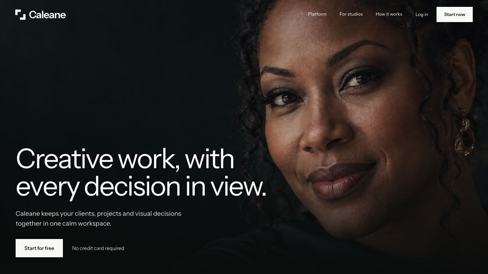

## 2. Problem statement — Strong, broadly relevant

Scattered briefs and feedback apply across creative disciplines. Keep the message. This capture shows the faded scroll state; motion and contrast across every state were not audited.

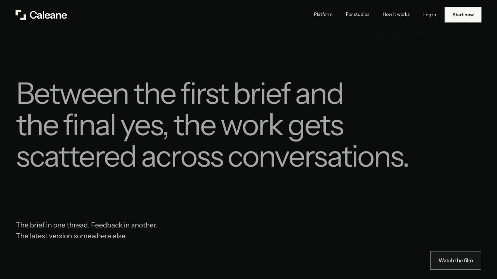

## 3. Product example — Clear function; narrow example

The strongest product explanation is entirely a wedding/floral project. Keep it, but introduce a brand identity or editorial project elsewhere in the product experience.

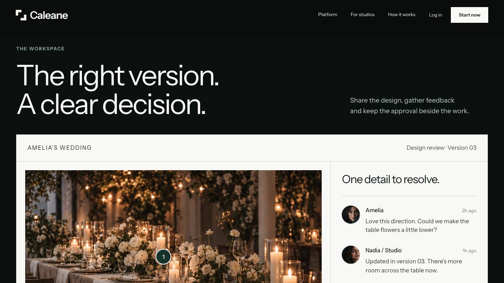

## 4. Workflow summary — Clear, somewhat repetitive

Brief, review and decision are easy to understand. The following three full-screen scenes repeat this story; future shortening should preserve the requested scroll interaction.

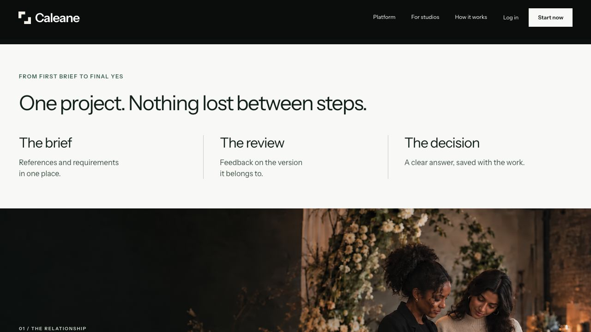

## 5. Relationship scene — Visually strong; repeated wedding signal

Another floral reception reinforces event styling as the principal audience. A graphic designer and client reviewing packaging or printed proofs would broaden this scene.

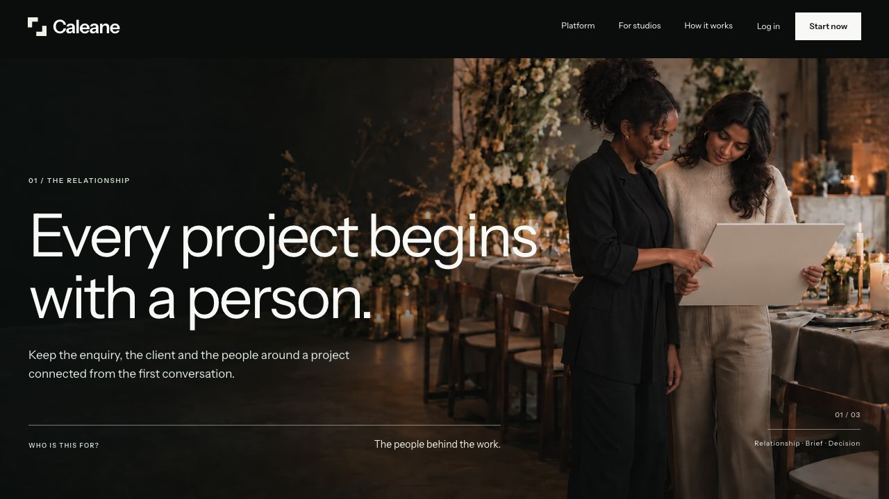

## 6. Brief scene — Recognisable work; limited setting range

Material samples make the role legible. Retain one interiors image, but avoid repeating the same high-end residential setting elsewhere.

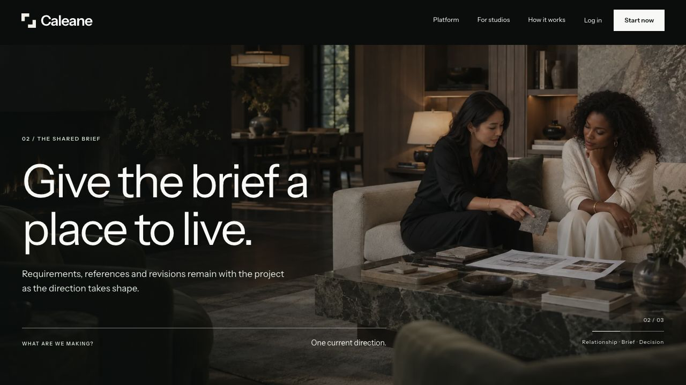

## 7. Decision scene — Useful production context; similar art direction

Camera equipment helps communicate a real job. A filmmaker or photographer reviewing selects would make the scene more distinct from the interiors and styling images.

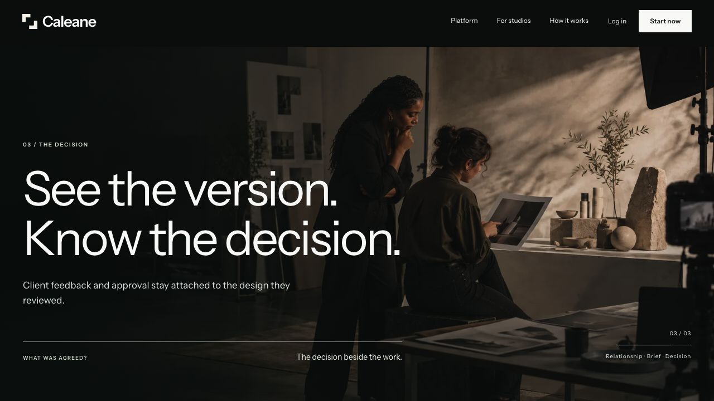

## 8. Profession directory — Broad labels; overlapping categories

Six labels still cluster around events, spaces and campaigns. Consider more distinct names: brand and graphic design, photography and film, interiors and spatial design, events and experiences. Faded list items need contrast and keyboard/motion testing; no compliance claim.

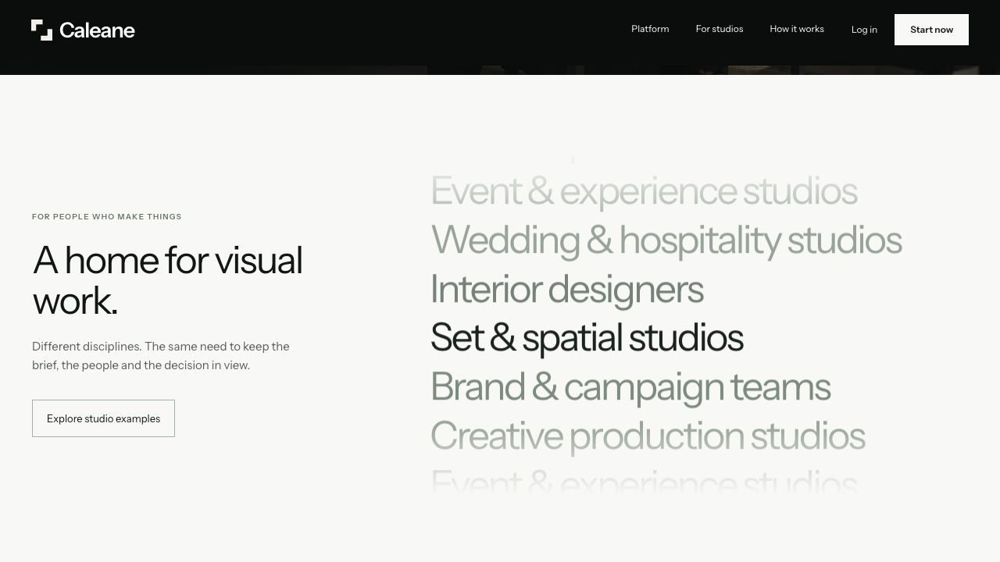

## 9. Studio gallery — Improved structure; narrow collective picture

All three scenes depict a similar polished, quiet working world. Replace the duplicate event or interiors shot with a print/packaging or digital creative review. Show different team sizes and more varied people.

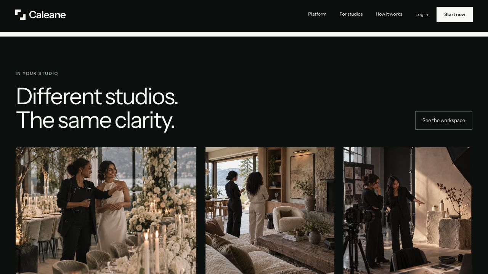

## 10. Access example — Clear distinction; repeats wedding project

The second product example reuses Amelia’s wedding. Use a second discipline to demonstrate breadth in actual work, not only labels. Small muted UI metadata should receive a separate contrast/zoom check.

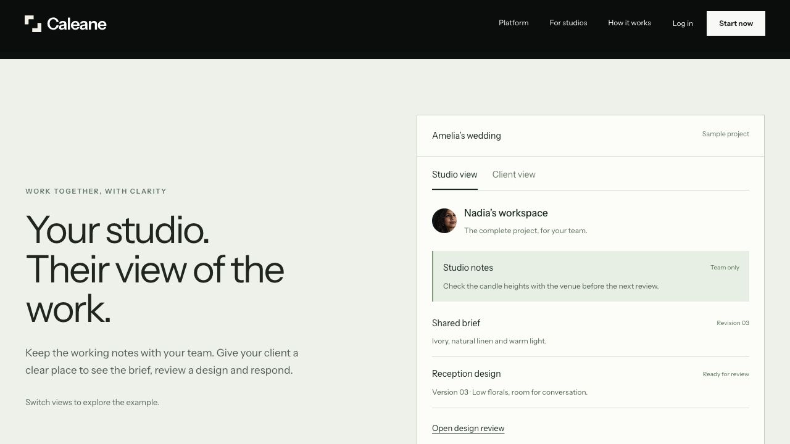

## 11. Closing — Clear invitation; repeats floral setting

The closing returns to women beside a floral installation. A mixed team at an active working table would widen the final impression while keeping warmth and the established grading. Heading-anchor capture crops the top of the image; no claim about full image framing.

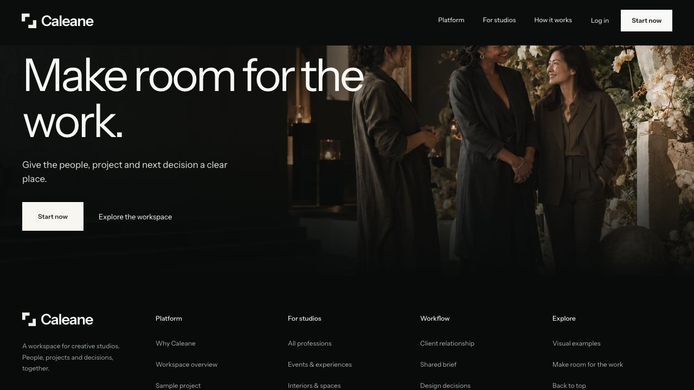

## 12. Footer — Improved scale

Reduced logo and clear grouping work. Small muted navigation and metadata merit contrast/zoom testing. No need to add more audience labels here.

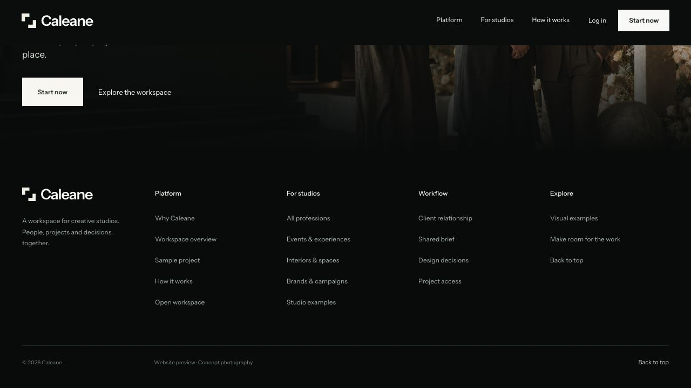

## Recommended first changes

1. Preserve the original close-up hero; replace two other frames with contextual portraits from graphic/brand and film/photo work.
2. Replace one repeated floral scene with a designer and client examining packaging proofs.
3. Replace the closing installation photo with a mixed team in a real working session.
4. Use a second project discipline in the access example or a project selector in the product demo.
5. Keep warm highlights, deep green shadows and negative space; vary daylight, work tools, posture, age presentation, clothing and team size.

Only depict workflows supported by the product; a film image should not imply video timecode review if unavailable. Avoid expanding into unrelated professions merely to look broad.
